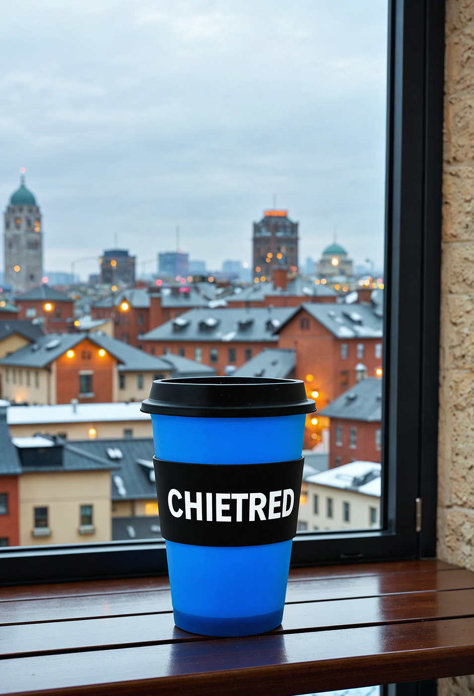
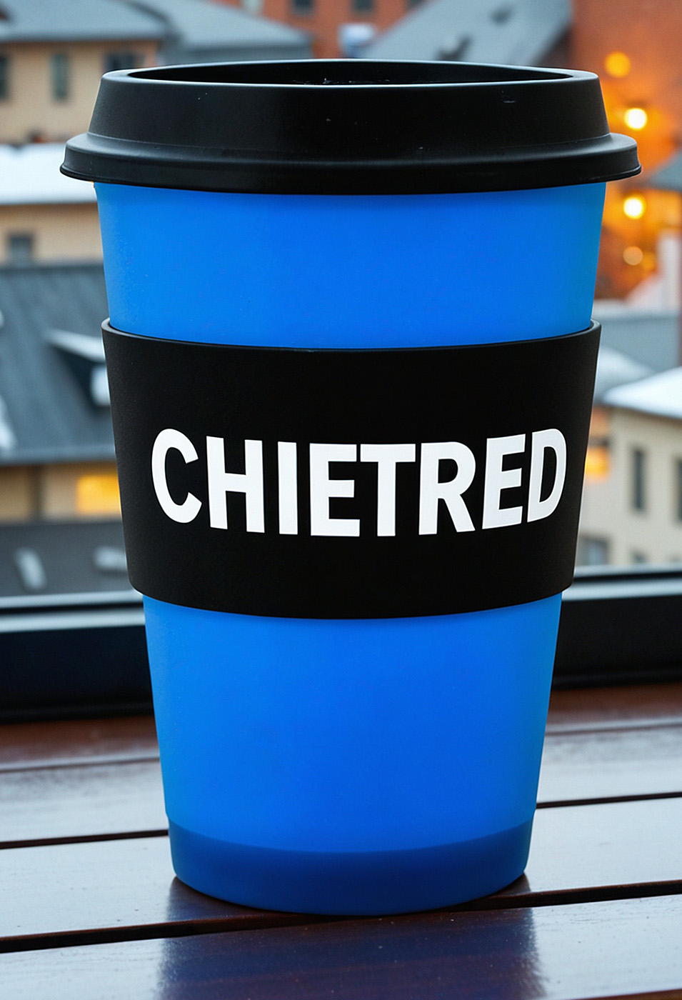

# MagicNodes — ComfyUI Render Pipeline (SD/SDXL)
Inicio simple. Resultados de nivel experto. Detalle confiable.
[](https://arxiv.org/abs/2510.12954) / [](https://arxiv.org/pdf/2510.15761)

<table>
  <tr>
    <td width="140" valign="top">
      
    </td>
    <td>
Resumen: MagicNodes es una "máquina de renderizado" multi-paso plug-and-play para modelos SD/SDXL. Inicio simple con un solo nodo, resultados de nivel experto. El núcleo es ZeResFDG (Frequency-Decoupled + Rescale + Zero-Projection) y el estabilizador QSilk Micrograin siempre activo, complementados por estabilizadores prácticos (NAG, máscaras locales, EPS, Muse Blend, Polish). Incluye un preset de cuatro pasos para salidas robustas, limpias y altamente detalladas.

Nuestro pipeline se ejecuta a través de varios pasos deliberados: los pasos iniciales ensamblan las formas globales, los pasos intermedios refinan las regiones importantes y los pasos finales pulen sin sobrecocinar la textura. Estabilizamos suavemente las amplitudes del "borrador interno de la imagen" (latent) y adaptamos el rango de valores permitidos por región: donde el modelo está seguro damos más libertad, y donde hay incertidumbre actuamos de forma más conservadora. El resultado son degradados limpios, bordes nítidos y detalle fotográfico incluso en resoluciones muy altas y, como efecto secundario en modelos SDXL, el texto se vuelve notablemente más estable y legible.
  </td>
</table>

Tenga en cuenta que la arquitectura de SDXL en sí misma tiene limitaciones y el resultado depende del éxito de la semilla (seed), la pureza de su prompt y la calidad de su modelo+LoRA.

Dibujo

| | |
|:--:|:--:|
|  |  |

Retrato Fotográfico

| | |
|:--:|:--:|
|  |  |

| | |
|:--:|:--:|
|  |  |

Foto Taza

| | |
|:--:|:--:|
|  |  |

Foto Perro

| | |
|:--:|:--:|
|  |  |

---

## Características
- ZeResFDG: División LF/HF, reescalado de energía y proyección cero (estabilidad inicial, nitidez final).
- NAG (Normalized Attention Guidance): normalización de la varianza de atención pequeña (rama positiva).
- Puerta espacial local: máscaras CLIPSeg opcionales para rostros/manos/poses.
- Escala EPS: sesgo de exposición pequeño en los pasos iniciales.
- QSilk Micrograin Stabilizer: suaviza suavemente picos raros y permite que la microtextura natural (piel, tela, vellos diminutos) se muestre, sin halos ni patrones de rejilla. Siempre activo, sin controles, costo casi nulo.
- Adaptive Quantile Clip (AQClip): adapta suavemente el rango permitido por región. Las áreas seguras mantienen más textura; las inciertas reciben un denoising más limpio. Basado en mosaicos (tiles) con mezcla fluida (sin costuras). El modo Attn opcional utiliza la confianza de atención para un equilibrio aún más inteligente.
- MGHybrid scheduler: stack de sigma híbrido Karras/Beta con mezcla de cola suave y un pequeño jitter de programación (inspirado en ZeSmart) para un denoising más estable y favorable al detalle; utilizado por CADE y SuperSimple por defecto.
- Seed Latent (MG_SeedLatent): inicializador de latent rápido y determinista alineado al stride del VAE; soporta inicios de ruido puro o inicios mixtos de imagen (encode + noise) para sesgar suavemente el contenido; listo para lotes (batch) y agnóstico a la resolución, combina bien con los tamaños de latent recomendados de SuperSimple para pipelines reproducibles.
- Muse Blend y Polish: mezcla posterior direccional y limpieza final que preserva las bajas frecuencias.
- SmartSeed (CADE Easy y SuperSimple): configure `seed = 0` para elegir automáticamente una buena semilla a través de una pequeña prueba de pocos pasos. Utiliza un barrido de baja discrepancia, evita motas/sobreexposición y, si está disponible, aprovecha CLIP-Vision (con `reference_image`) y el texto de enfoque de CLIPSeg para favorecer candidatos alineados semánticamente. Registra `Smart_seed_random: Start/End` y expone la elección final en la salida `selected_seed`.
<b>Recomiendo encarecidamente trabajar con SmartSeed.</b>
- El pipeline CADE2.5 no solo reescala la imagen, sino que itera y añade pequeños detalles cuidadosamente en cada etapa.

## Hardware
- El pipeline está diseñado para hardware potente (probado en RTX5090 (32Gb) y RAM 128Gb); intente mantener el latent inicial muy pequeño, ya que hay un reescalado en los pasos y corre el riesgo de obtener errores si aumenta demasiado los valores iniciales.
- Latent inicial ~ 672x944 -> final ~ 3688x5192 a lo largo de 4 pasos.
- Notas
  - Reducir el latent inicial (ej. 512x768) o menos, reduce tanto la VRAM como la RAM.

## 💥 Memoria
- ¡En cada paso, la imagen se reescala desde el paso anterior! Tenga en cuenta que la imagen final puede no caber en la memoria de su PC si el latent inicial es muy alto.

## Instalación (ComfyUI >=0.3.60)
Preparación:
Recomiendo actualizar la versión de pytorch a: 2.8.0+cu129.
1. Instalación de PyTorch: `pip install torch==2.8.0 torchvision==0.23.0 torchaudio==2.8.0 --index-url https://download.pytorch.org/whl/cu129`
2. Descarga e instalación manual de CUDA: https://developer.nvidia.com/cuda-12-9-0-download-archive?target_os=Windows&target_arch=x86_64&target_version=11&target_type=exe_local
3. Instale `SageAttention 2.2.0`, manualmente desde `https://github.com/thu-ml/SageAttention` o use el script `scripts/check_sageattention.bat`. La instalación tarda unos minutos, espere a que termine.
p.s.: Para que funcione, es imprescindible instalar `SageAttention v.2.2.0`, la `versión 1.0.6` no es apta para el pipeline.

Siguiente:
1. Clone o descargue este repositorio en `ComfyUI/custom_nodes/`
2. Instale los ayudantes: `pip install -r requirements.txt`
3. Recomiendo descargar mi LoRA negativo `mg_7lambda_negative.safetensors` en HF https://huggingface.co/DD32/mg_7lambda_negative/blob/main/mg_7lambda_negative.safetensors y colocar el archivo en ComfyUI, en `ComfyUI/models/loras`
4. Si tiene `custom_nodes/comfyui_controlnet_aux/` instalado y hay un modelo de profundidad, generalmente se "detecta" automáticamente; si no, descargue el modelo `depth_anything_v2_vitl.pth` https://huggingface.co/depth-anything/Depth-Anything-V2-Large/tree/main y colóquelo dentro de la carpeta `depth-anything/`.
5. Descargue https://huggingface.co/lllyasviel/sd_control_collection/tree/main `diffusers_xl_depth_full.safetensors` y colóquelo en `ComfyUI/models/controlnet`
6. Descargue un modelo CLIP Vision y colóquelo en `ComfyUI/models/clip_vision` (ej., https://huggingface.co/openai/clip-vit-large-patch14; alternativa pesada: https://huggingface.co/laion/CLIP-ViT-H-14-laion2B-s32B-b79K). SuperSimple/CADE lo utilizará para el pulido basado en referencias.
7. Flujos de trabajo (Workflows)
La carpeta `workflows/` contiene grafos listos para usar:
- `mg_SuperSimple-Workflow.json` — pipeline de un solo nodo (2/3/4 pasos) con presets.
- `mg_Easy-Workflow.json` — la misma lógica construida a partir de nodos Easy individuales.
Puede guardar este flujo de trabajo en ComfyUI `ComfyUI/user/default/workflows`
6. Reinicie ComfyUI. Los nodos aparecerán bajo las categorías "MagicNodes".

Recomiendo encarecidamente usar el flujo `mg_Easy-Workflow` + configuración predeterminada + su modelo y mi LoRA negativo `mg_7lambda_negative.safetensors` para mejores resultados.

También recomiendo probar el flujo `mg_i2i_Easy-Workflow` para remasterizar sus imágenes.

## 🚀 Inicio Rápido "Un Solo Nodo" (MG_SuperSimple)
Comience con `MG_SuperSimple` para el camino más sencillo:
1. Arrastre `MG_SuperSimple` al grafo.
2. Conecte `model / positive / negative / vae / latent` y un módulo `Load ControlNet Model`.
3. Elija `step_count` (3/4) y ejecute.

o cargue `mg_SuperSimple-Workflow` en el panel de ComfyUI.

Notas:
- Cuando "Custom" está desactivado, los presets controlan totalmente los parámetros.
- Cuando "Custom" está activado, los controles CADE visibles anulan los presets de pasos en todas las etapas; el Paso 1 sigue imponiendo `denoise=1.0`.
- CLIP Vision (si está conectado) se aplica a partir del Paso 2; si no se proporciona una imagen de referencia, SuperSimple usa la imagen del paso anterior como referencia.
- El Paso 1 y el Paso 2 son pasos de precalentamiento.

## ❗Consejos
(!) Casi siempre hay artefactos en el primer paso, no les preste atención, se eliminarán en los siguientes pasos. Mantenga su prompt limpio y lógico, no duplique detalles y tenga cuidado con los símbolos.

0) `MG_SuperSimple-Workflow` es un poco menos flexible que `MG_Easy-Workflow`, pero extremadamente sencillo de usar. Si solo quiere un resultado estable e interesante, comience con SuperSimple.

1) LoRA negativo recomendado: `mg_7lambda_negative.safetensors` con `strength_model = -1.0`, `strength_clip = 0.2`. Coloque los archivos LoRA en `ComfyUI/models/loras` para que aparezcan en el selector.

2) Samplers: recomiendo usar `ddim` para muchos casos (estilo Dibujo y Realismo). Scheduler: use `MGHybrid` en este pipeline.

3) Denoise: más alto -> más expresivo y vívido; puede subir hasta 1.0. Lo mismo aplica al CFG: más alto -> más expresivo pero puede introducir artefactos. Rango de CFG sugerido: ~4.5–8.5.

4) Si ve artefactos no deseados en el paso final (4to), reduzca ligeramente el denoise a ~0.5–0.6 o simplemente cambie la semilla.

5) Puede obtener resultados interesantes repitiendo pasos (en flujos Easy/Hard), ej., `1 -> 2 -> 3 -> 3`. ¡Simplemente experimente!

6) Latent inicial recomendado cercano a ~672x944 (otras relaciones de aspecto están bien). Con esto, el paso 4 produce ~3688x5192. Tamaños iniciales más grandes están bien si el modelo y su hardware lo permiten.

7) Hay semillas con mala suerte; simplemente pruebe con otra. (Podríamos añadir estabilización a este proceso más adelante).

8) Rara vez, el paso 3 puede mostrar un extraño artefacto de rejilla (en flujos Easy y Hard). Si sucede, intente cambiar el CFG o la semilla. La causa raíz aún está bajo investigación.

9) Los resultados dependen de la calidad del checkpoint/LoRA. El pipeline "exprime" todo lo que SDXL y su modelo pueden ofrecer, por lo que prefiera checkpoints de alta calidad y LoRAs que no estén sobreentrenados.

10) Evite usar más de 3 LoRAs a la vez, y mantenga solo un LoRA "principal" (uno que confíe que no está sobreentrenado). Demasiados LoRAs o LoRAs muy fuertes pueden arruinar los resultados.

11) Intente conectar imágenes de referencia en cualquier flujo; puede obtener resultados inusuales e interesantes.

12) Muy a menudo, la imagen en el `paso 3 es de muy buena calidad`, pero suele carecer de nitidez. Pero si tiene un `sistema débil`, puede `limitarse a 3 pasos`.

13) SmartSeed (selección automática de semilla): configure `seed = 0` en Easy o SuperSimple. El nodo tomará varias semillas candidatas y hará una prueba rápida de pocos pasos para elegir una equilibrada. Verá los registros `Smart_seed_random: Start` y `Smart_seed_random: End. Seed is: <número>`, y el valor elegido estará disponible en la salida `selected_seed`. Use cualquier semilla distinta de cero para ejecuciones totalmente deterministas.

14) El 4to paso a veces tarda mucho en guardar la imagen, simplemente espere a que termine el proceso; depende de la resolución inicial que haya configurado.

15) El nodo `CombiNode` es opcional, puede reemplazarlo con pipelines estándar de ComfyUI.

<br></br>
<details>
<summary>Estructura del Repositorio</summary>

## Estructura del Repositorio
```
MagicNodes/
├─ README.md
├─ LICENSE                      # AGPL-3.0-or-later
├─ assets/
├─ docs/
│  ├─ EasyNodes.md
│  ├─ HardNodes.md
│  └─ hard/
│     ├─ CADE25.md
│     ├─ ControlFusion.md
│     ├─ UpscaleModule.md
│     ├─ IDS.md
│     └─ ZeSmartSampler.md
│ 
├─ mod/
│  ├─ easy/
│  │  ├─ mg_cade25_easy.py
│  │  ├─ mg_controlfusion_easy.py
│  │  └─ mg_supersimple_easy.py
│  │  └─ preset_loader.py
│  ├─ hard/
│  │  ├─ mg_cade25.py
│  │  ├─ mg_controlfusion.py
│  │  ├─ mg_tde2.py
│  │  ├─ mg_upscale_module.py
│  │  ├─ mg_ids.py
│  │  └─ mg_zesmart_sampler_v1_1.py
│  │
│  ├─ mg_cleanup.py
│  ├─ mg_combinode.py
│  ├─ mg_latent_adapter.py
│  ├─ mg_sagpu_attention.py
│  └─ mg_seed_latent.py
│  
├─ pressets/
│  ├─ mg_cade25.cfg
│  └─ mg_controlfusion.cfg
│ 
├─ scripts/
│  ├─ check_sageattention.bat
│  └─ check_sageattention.ps1
│ 
├─ depth-anything/              # place Depth Anything v2 weights (.pth), e.g., depth_anything_v2_vitl.pth
│  └─ depth_anything_v2_vitl.pth
│ 
├─ vendor/
│  └─ depth_anything_v2/        # vendored Depth Anything v2 code (Apache-2.0)
│ 
├─ workflows/ 
│  ├─ mg_SuperSimple-Workflow.json
│  ├─ mg_Easy-Workflow.json  
│  └─ mg_i2i_Easy-Workflow.json        
|  
└─ requirements.txt
```

</details>
<br></br>
<details>
<summary> Notas y Guías de Módulos</summary>
<p>Un conjunto compacto de notas por módulo, controles y consejos de uso que cubren Control Fusion, CADE 2.5, MG_CleanUp y el adaptador experimental Magic Latent Adapter.</p>

## Control Fusion (mg_controlfusion.py, mg_controlfusion_easy.py,)
- Construye máscaras de profundidad + bordes preservando la relación de aspecto; modo de máscara optimizado para alta resolución.
- Controles de superficie clave: `edge_alpha`, `edge_smooth`, `edge_width`, `edge_single_line`/`edge_single_strength`, `edge_depth_gate`/`edge_depth_gamma`.
- La vista previa puede reflejar opcionalmente la fuerza de ControlNet a través de `preview_show_strength` y `preview_strength_branch`.

## CADE 2.5 (mg_cade25.py, mg_cade25_easy.py)
- Preflight determinista: CLIPSeg anclado a CPU; reinicio de máscara de vista previa; ruido vinculado a `iter_seed`.
- CADE Easy añade una salida INT `selected_seed` después de `mask_preview`; los slots existentes de LATENT, IMAGE y máscara mantienen su orden.
- Codificación/Decodificación: alineada al stride, con mayor solapamiento para >2K para evitar artefactos.
- Modo Polish (refinamiento final de alta resolución):
  - `polish_enable`, `polish_keep_low` (forma global de la referencia), `polish_edge_lock`, `polish_sigma`.
  - Inicio suave mediante `polish_start_after` y `polish_keep_low_ramp`.
- Soporta `eps_scale` para un modelado suave de la exposición.

## MG_CleanUp (nodo final de limpieza de memoria)

- Propósito: un pequeño nodo al final del grafo que libera agresivamente RAM/VRAM y solicita al SO que devuelva las páginas liberadas. Colóquelo al final de un flujo de trabajo (idealmente justo después de SaveImage).
- Retornos: paso a través de `LATENT` y una pequeña vista previa de `IMAGE` (32×32). Para que la limpieza funcione, asegúrese de conectar el nodo `Preview` a la salida `IMAGE`.
- Qué hace (dos pases: inmediato y +150 ms):
  - Sincronización de CUDA, `gc.collect()`, `torch.cuda.empty_cache()` + `ipc_collect()`.
  - Eliminación suave del caché del administrador de modelos de Comfy; cuando `hard_trim=true` también descarga los modelos cargados (se recargarán en la siguiente ejecución).
  - Elimina cachés ligeros de LRU/vista previa (cuando están disponibles).
  - Windows: recorta el conjunto de trabajo (`SetProcessWorkingSetSize` + `EmptyWorkingSet`) y purga del sistema el caché/standby según el mejor esfuerzo.
  - Linux: `malloc_trim(0)` para liberar el heap fragmentado al SO.
  - Registra cuánta RAM/VRAM fue liberada en cada pase.

- Entradas:
  - `hard_trim` (bool): habilita la limpieza más fuerte (descarga modelos, recortes a nivel de SO).
  - `sync_cuda` (bool): sincroniza CUDA antes de la limpieza (recomendado).
  - `hires_only_threshold` (int): se ejecuta solo cuando el lado más largo del latent ≥ umbral; `0` = siempre.

Notas:
- Debido a que los modelos se descargan en `hard_trim`, la siguiente ejecución del flujo puede tardar un poco más en iniciar (los modelos se recargarán).
- Use este nodo solo al final de un grafo; es intencionalmente agresivo.

## Depth Anything v2 (vendor)
- Se encuentra en `vendor/depth_anything_v2`; licencia Apache-2.0.

Modelos de profundidad (Depth Anything v2)
- Coloque los pesos de DA v2 (`.pth`) en `depth-anything/`. Recomendado: `depth_anything_v2_vitl.pth` (ViT-L). Los nombres soportados incluyen:
  `depth_anything_v2_vits.pth`, `depth_anything_v2_vitb.pth`, `depth_anything_v2_vitl.pth`, `depth_anything_v2_vitg.pth`,
  y las variantes métricas `depth_anything_v2_metric_vkitti_vitl.pth`, `depth_anything_v2_metric_hypersim_vitl.pth`.
- ControlFusion detecta automáticamente la configuración correcta a partir del nombre del archivo y usa esta ruta por defecto. Puede anularlo mediante el parámetro `depth_model_path` (preset) si es necesario.
- Si no se encuentran pesos, ControlFusion vuelve elegantemente a una profundidad pseudo-luminancia, pero los resultados son mejores con DA v2.
- Dónde obtener los pesos: consulte el repositorio oficial de Depth Anything v2 (https://github.com/DepthAnything/Depth-Anything-V2) y su página de modelos de Hugging Face (https://huggingface.co/Depth-Anything) para archivos `.pth` preentrenados.

## MG_ZeSmartSampler (Experimental)
- Sampler personalizado que construye programas de sigma híbridos (mezcla Karras/Beta) con suavizado de cola.
- Las entradas/salidas coinciden con KSampler: `MODEL/SEED/STEPS/CFG/base_sampler/schedule/CONDITIONING/LATENT` -> `LATENT`.
- Parámetros clave: `hybrid_mix`, `jitter_sigma`, `tail_smooth`, modelado opcional tipo PC2 (`smart_strength`, `target_error`, `curv_sensitivity`).

## Seed Latent (mg_seed_latent.py)
- Propósito: inicializador de LATENT rápido alineado al stride del VAE (4xC, H/8, W/8). Puede comenzar desde ruido puro o mezclar la codificación de una imagen de entrada con ruido para sesgar suavemente el contenido.
- Entradas:
  - `width`, `height`, `batch_size`
  - `sigma` (amplitud del ruido) y `bias` (desplazamiento aditivo)
  - `vae` e `image` opcionales cuando `mix_image` está activado.
- Salida: dict `LATENT` `{ "samples": tensor }` listo para alimentar a CADE/SuperSimple.
- Notas de uso:
  - Mantenga las dimensiones como múltiplos de 8; tamaños iniciales recomendados alrededor de ~672x944 (otras relaciones de aspecto funcionan). Con la escala predeterminada de SuperSimple, el paso 4 llega cerca de ~3688x5192.
  - `mix_image=True` codifica la imagen proporcionada vía VAE y añade ruido: una forma suave de mantener la estructura global permitiendo el refinamiento posterior.
  - Para comparabilidad entre ejecuciones, mantenga fija la semilla del sampler (en SuperSimple/CADE). SeedLatent no expone una semilla propia; la variación es controlada principalmente por la semilla del sampler.
- Compatible con lotes: `batch_size>1` produce latents independientes del tamaño elegido.

## Magic Latent Adapter (mg_latent_adapter.py) !experimental!
- Propósito: pequeño nodo adaptador que genera o adapta un `LATENT` para que coincida con el formato de latent del modelo objetivo (canales y dimensiones), incluyendo diseños 5D (`NCDHW`) cuando sea requerido. Dos modos: `generate` (crea un latent nuevo alineado al stride del VAE) y `adapt` (cambia la forma/canales de un latent existente).
- Cómo funciona: depende de `fix_empty_latent_channels` de Comfy y lee el `latent_format` del modelo para ajustar el recuento de canales; alinea el tamaño espacial al stride del VAE; maneja 4D (`NCHW`) y 5D (`NCDHW`).
- Experimental: añadido para facilitar el soporte temprano y experimental para modelos tipo FLUX/Qwen reduciendo la fricción de forma/dimensión. Aún evolucionando; trátelo como opcional.
- Uso: colóquelo antes de CADE/su sampler. En modo `generate` también puede habilitar la mezcla de imágenes vía VAE; en modo `adapt` alimente cualquier `LATENT` previo y el `MODEL` actual. Un interruptor de familia simple (`auto / SD / SDXL / FLUX`) controla el fallback del stride cuando no se proporciona VAE.
- Notas: la calidad con modelos FLUX/Qwen también depende del uso de los codificadores de texto/nodos de condicionamiento adecuados para esas familias; este adaptador solo resuelve las formas del latent, no los desajustes de condicionamiento.

</details>
<br></br>

## Documentación
- Descripción general de nodos Easy y `MG_SuperSimple`: `docs/EasyNodes.md`
- Índice de documentación de nodos Hard: `docs/HardNodes.md`

## Dependencias (Por qué estos paquetes)
- transformers — usado por CADE para CLIPSeg (CIDAS/clipseg-rd64-refined) para construir máscaras impulsadas por texto (ej., rostro/manos). Si falta, CLIPSeg se desactiva elegantemente.
 
- opencv-contrib-python — stack de bordes de ControlFusion (Pyramid Canny, adelgazamiento vía ximgproc), ops morfológicas, suavizado ligero.
- Pillow — E/S de imágenes y pequeñas conversiones en pipelines de vista previa/CLIPSeg.
- scipy — ruta preferida de filtrado Gaussiano para IDS (calidad). Si no está instalado, IDS vuelve a una implementación de PyTorch.
- sageattention — kernels de atención acelerados (elige automáticamente un kernel por arquitectura de GPU); el parche de CADE/atención vuelve a la atención estándar si no está presente.

Extras opcionales
- controlnet-aux — cargador alternativo para Depth Anything v2 si no usa la implementación vendored (no requerido por defecto).
  

## Preprint
- CADE 2.5 - ZeResFDG
- PDF: https://arxiv.org/pdf/2510.12954.pdf
- arXiv: https://arxiv.org/abs/2510.12954

- CADE 2.5 - QSilk
- PDF: https://arxiv.org/pdf/2510.15761
- arXiv: https://arxiv.org/abs/2510.15761


### Cómo Citar
```
@misc{rychkovskiy2025cade25zeresfdg,
      title={CADE 2.5 - ZeResFDG: Frequency-Decoupled, Rescaled and Zero-Projected Guidance for SD/SDXL Latent Diffusion Models}, 
      author={Denis Rychkovskiy},
      year={2025},
      eprint={2510.12954},
      archivePrefix={arXiv},
      primaryClass={cs.CV},
      url={https://arxiv.org/abs/2510.12954}, 
}
```
```
@misc{rychkovskiy2025qsilkmicrograinstabilizationadaptive,
      title={QSilk: Micrograin Stabilization and Adaptive Quantile Clipping for Detail-Friendly Latent Diffusion}, 
      author={Denis Rychkovskiy},
      year={2025},
      eprint={2510.15761},
      archivePrefix={arXiv},
      primaryClass={cs.CV},
      url={https://arxiv.org/abs/2510.15761}, 
}
```

## Atribución (solicitud amable)
Si utiliza este trabajo o partes del mismo, considere añadir el siguiente crédito en su README/About/créditos: "Incluye CADE 2.5 (ZeResFDG, QSilk) de Denis Rychkovskiy (“DZRobo”)"


## Licencia y Créditos
- Licencia: AGPL-3.0-or-later (ver `LICENSE`)


## Soporte
Si este proyecto le ha ahorrado tiempo, puede dejar una propina:
- GitHub Sponsors: https://github.com/sponsors/1dZb1
- Bymeacoffee: https://buymeacoffee.com/dzrobo
